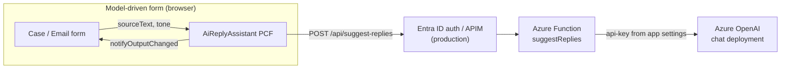

# pcf-ai-assistant

[](https://github.com/mateusmirandaia/pcf-ai-assistant/actions/workflows/ci.yml)

A Power Apps Component Framework (PCF) field control for Dynamics 365 model-driven forms that drafts replies to a customer message. Put it on a Case or Email form, point it at the description or email body, and agents get two or three suggested replies they can drop into the reply column with one click.

The control is a React virtual control that uses the platform's own React and Fluent UI v9, so it ships a ~30 KB bundle and looks like the rest of the form. Model calls go through a small Azure Function in [`/api`](api) so the browser never holds an Azure OpenAI key.

> Screenshots: not included yet. They will be added from a real environment rather than mocked up.

## How it works



1. The agent clicks **Suggest reply**. The control posts `{ sourceText, tone }` to the configured endpoint, with a 20 second client-side timeout.
2. The function validates the request (required text, allowed tone, length cap, body size cap), builds the prompt server-side and calls the Azure OpenAI deployment in JSON mode.
3. The function returns `{ suggestions: [{ id, text }] }`. The control renders each one as a card.
4. **Use this** writes the text into the bound column through `notifyOutputChanged` / `getOutputs`, so the form marks the record dirty and runs any OnChange logic exactly as if the agent had typed it. Nothing is saved until the agent saves.

### Why a proxy instead of calling Azure OpenAI from the control

Anything a PCF control can read, the user can read: manifest properties, environment variables, the bundle itself. An API key there is a published key. The proxy also gives you one place to:

- keep the prompt and model settings out of the client, so they can change without redeploying the solution;
- enforce input limits and reject junk before it costs tokens;
- add authentication, rate limiting and logging in front of the model.

The prompt treats the customer text as data and fences it off from the instructions. That reduces, but does not eliminate, prompt-injection risk, which is one more reason a human always reviews and sends the reply.

## Control properties

| Property | Type | Usage | Description |
| --- | --- | --- | --- |
| `replyDraft` | Multiple lines of text | bound | Column that receives the chosen suggestion. |
| `sourceText` | Multiple lines of text | input | Text to answer. Bind it to a column such as `description` on Case or the email body. |
| `tone` | Enum: `formal`, `friendly`, `concise` | input | Style requested from the backend. Defaults to `formal`. |
| `apiEndpoint` | Single line of text | input | HTTPS URL of the function, e.g. `https://<app>.azurewebsites.net/api/suggest-replies`. Plain HTTP is accepted only for `localhost`. |

The control disables itself when the form is read-only, the record is inactive, or column-level security makes `replyDraft` non-editable.

## Repository layout

```
AiReplyAssistant/          PCF control
  ControlManifest.Input.xml
  index.ts                 ReactControl lifecycle (init / updateView / getOutputs)
  components/              SuggestionPanel, SuggestionCard
  hooks/useSuggestions.ts  request state and cancellation
  services/                fetch client, endpoint validation, shared types
  strings/                 resx labels
  __tests__/               Jest + Testing Library
api/                       Azure Functions (Node, v4 programming model)
  src/functions/suggestReplies.ts
  src/lib/                 config, validation, prompt, Azure OpenAI call
  test/
pcf-ai-assistant.pcfproj   used by `pac solution add-reference`
```

## Prerequisites

- Node.js 20 or 22
- [Power Platform CLI](https://learn.microsoft.com/power-platform/developer/cli/introduction) (`pac`)
- [Azure Functions Core Tools v4](https://learn.microsoft.com/azure/azure-functions/functions-run-local) to run the API locally
- An Azure OpenAI resource with a chat model deployment
- .NET SDK or Visual Studio Build Tools for `dotnet build` / `msbuild` when packaging the solution

## Local development

### Control

```bash
npm install
npm start            # builds and opens the PCF test harness on http://localhost:8181
```

In the harness, set `apiEndpoint` to `http://localhost:7071/api/suggest-replies` and type something into `sourceText`.

Other scripts:

```bash
npm run lint
npm run typecheck    # run `npm run refreshTypes` first on a fresh clone
npm test
npm run build:prod
```

### API

```bash
cd api
cp local.settings.example.json local.settings.json   # then fill in your own values
npm install
npm start                                            # func start on http://localhost:7071
```

`local.settings.json` is git-ignored. The example file only contains placeholders; keep real keys out of the repository and out of the control's configuration.

| Setting | Required | Notes |
| --- | --- | --- |
| `AZURE_OPENAI_ENDPOINT` | yes | `https://<resource>.openai.azure.com/` |
| `AZURE_OPENAI_API_KEY` | yes | Use a Key Vault reference in Azure. |
| `AZURE_OPENAI_DEPLOYMENT` | yes | Name of the chat deployment, not the model name. |
| `AZURE_OPENAI_API_VERSION` | no | Defaults to `2024-10-21`. |
| `MAX_SOURCE_CHARS` | no | Defaults to `4000`. Longer input is rejected with 400. |

The example settings allow CORS from the test harness origin. In Azure, configure CORS on the Function App (or APIM) for your Dynamics 365 org URL only.

## Deploying

### 1. API

Deploy `api/` to a Function App on Node 22 (`func azure functionapp publish <app-name>` or your pipeline of choice) and set the app settings above.

The HTTP trigger uses `authLevel: "anonymous"` deliberately: a function key would have to live in the browser and would protect nothing. **Do not expose it to the internet as is.** Before real users touch it, put one of these in front:

- **App Service authentication (Easy Auth) with Microsoft Entra ID**, restricted to your tenant and to an app registration that represents the control.
- **Azure API Management** with a `validate-jwt` policy, rate limiting per user, and the function locked down to APIM's IP or a private endpoint.

Also prefer a managed identity with the `Cognitive Services OpenAI User` role over an API key once the function is in Azure.

### 2. Solution

Update the `<domain>` under `external-service-usage` in the manifest to your Function App or APIM host. Declaring the external call is how the platform knows the control talks to an outside service, and it classifies the control as premium for licensing.

```bash
npm run build:prod

mkdir solution && cd solution
pac solution init --publisher-name <publisher> --publisher-prefix <prefix>
pac solution add-reference --path ..
dotnet build -c Release        # or: msbuild /t:build /restore /p:configuration=Release
```

The managed/unmanaged zip ends up in `solution/bin/Release`. Import it with `pac solution import` or through the maker portal. For a quick inner loop against a dev environment, `pac pcf push --publisher-prefix <prefix>` skips the solution step.

### 3. Form

In the form designer, add the control to a multiline text column such as a custom `Reply draft` column, bind `sourceText` to the description or email body column, pick a tone, and set the API URL. Publish.

## Roadmap

- Authenticated calls from the control: acquire a token for the API, or route through a Dataverse Custom API so the platform session handles identity.
- Read case context (product, customer, recent activities) to ground the suggestions.
- Stream the response so the first suggestion appears sooner.
- Localised labels beyond `1033`, and replies that follow the user's UI language when the customer message is ambiguous.
- Telemetry on which suggestion was used and how much it was edited before sending.

## License

[MIT](LICENSE)
